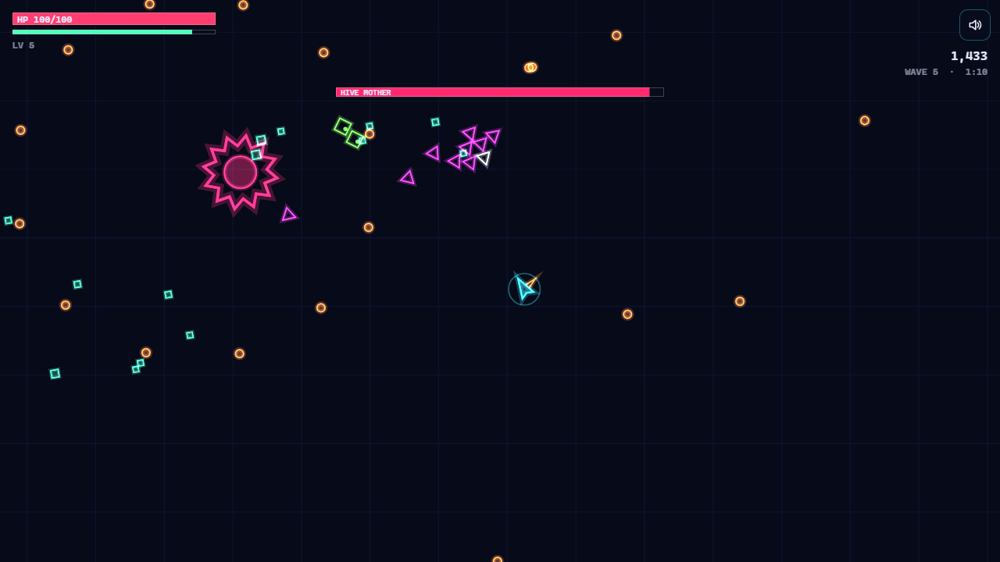
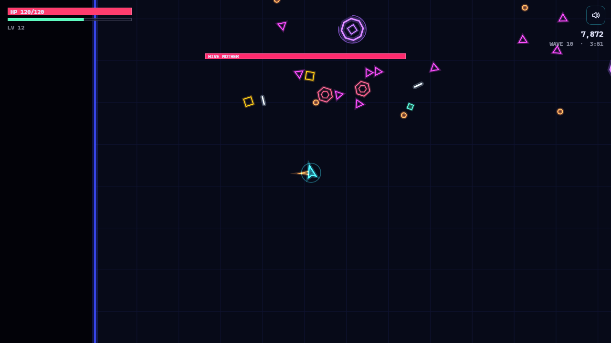

# Neon Swarm

A wave-survival arena shooter with roguelite upgrades, written in **vanilla JavaScript and Canvas 2D**.
No engine, no build step and no asset files: the graphics are drawn as vector shapes and every sound
effect is synthesized at runtime with the Web Audio API. It runs on desktop (keyboard) and on phones (touch).

### ▶ [Play it in the browser](https://alexden28.github.io/neon-swarm/)



## Gameplay

- **Move and survive.** The ship fires automatically at the nearest enemy, so the player's job is
  positioning: kiting the swarm, collecting XP gems and dashing through danger (the dash grants
  invulnerability frames).
- **Six enemy types with their own behaviour:**
  | Enemy | Behaviour |
  |---|---|
  | Drone | Swarms straight at you |
  | Dasher | Stops, shows a dashed warning line, then charges along it |
  | Gunner | Keeps a ring distance, strafes and fires aimed shots |
  | Splitter | Breaks into three fast minis when destroyed |
  | Brute | Slow, heavy, shrugs off knockback |
  | **Hive Mother** (boss, every 5th wave) | Radial bullet bursts and drone summons; enrages below 50% HP |
- **12 stackable upgrades.** Every level-up offers 3 of them (fire rate, damage, split shot, piercing,
  crits, orbiting blades, regeneration, magnet, dash cooldown and more), each with a stack cap.
- **Game feel:** hit-stop on damage, trauma-based screen shake, hit flashes, warp-in telegraphs,
  additive-blended particles and a procedural sound effect for every event.

| Controls | Desktop | Touch |
|---|---|---|
| Move | `WASD` / arrow keys | Drag anywhere (floating joystick) |
| Dash | `Space` | Second finger or the DASH button |
| Upgrades | `1` `2` `3` or click | Tap a card |
| Pause / sound | `Esc` / `M` | Buttons in the corner |



## Technical highlights

- **Simulation separated from presentation.** `src/game/world.js` has no DOM, canvas or audio
  dependency. It mutates plain data and pushes events (`hit`, `kill`, `levelup` and so on) into a queue,
  and the renderer, the audio layer and the UI react to those events. Because of this split the whole
  game can run headlessly in Node.
- **Fixed timestep** (60 Hz simulation, variable-rate rendering, frame-time clamping) so gameplay
  is identical on 60 Hz and 144 Hz screens.
- **Deterministic runs.** All gameplay randomness comes from a seeded PRNG (mulberry32), so a seed
  reproduces a run exactly (`?seed=123`). A test checks this.
- **Collision:** a uniform-grid spatial hash handles the broadphase, a swept segment-vs-circle test
  stops fast bullets from tunnelling through small enemies, and a soft mass-weighted separation keeps
  the swarm from collapsing into one blob.
- **No per-frame garbage in the hot paths.** The particles are a struct of typed arrays with
  swap-remove, entity lists are compacted in place, and the hash cells are reused between ticks.
- **Wave director.** Each wave gets a point budget that is spent on the enemy types unlocked so far,
  using weighted picks. Enemy HP scales with the wave number and every fifth wave brings a boss.
  Everything is tunable in `config.js`.
- **Autopilot bot** (`autopilot.js`). It plays the demo behind the title screen and drives the
  balance tests: a 5-minute run is simulated in about 0.6 s.
- **Profiling-driven fix.** A CPU profile of the headless simulation showed 57% of tick time spent
  clearing the spatial hash. Tracking only the occupied cells made a tick about 40× cheaper
  (≈1.4 ms down to ≈36 µs).

## Architecture

```
src/
├── main.js            app modes (title / play / pause / level-up / game over), event routing
├── engine/            generic, game-agnostic pieces
│   ├── loop.js        fixed-timestep loop
│   ├── input.js       keyboard + floating virtual joystick
│   ├── audio.js       procedural Web Audio SFX
│   ├── spatialHash.js broadphase collision grid
│   ├── rng.js         seeded PRNG
│   └── math.js        damping, swept collision helpers
└── game/
    ├── config.js      all balance numbers
    ├── world.js       the simulation: player, enemy AI, weapons, XP, waves
    ├── director.js    wave composition (pure functions)
    ├── upgrades.js    upgrade pool and stacking rules
    ├── autopilot.js   steering bot for the demo and the tests
    ├── render.js      camera, shake, drawing, HUD
    ├── particles.js   typed-array particle system
    ├── ui.js          DOM menus and level-up cards
    └── storage.js     best score (localStorage, optional)
```

## Running locally

ES modules need to be served over HTTP (opening `index.html` from disk won't work):

```bash
npm start            # npx http-server on http://localhost:8080
# or
python -m http.server 8080
```

## Tests

```bash
npm test             # Node 20+, uses the built-in node:test runner
```

There are 18 tests: PRNG determinism, the spatial hash checked against brute force, swept collision,
fixed-timestep behaviour, wave-budget invariants, upgrade stacking rules, combat scenarios
(kills, splitter minis, i-frames, level-up pause), a 5-minute headless bot run with state
invariants, and seed determinism. They run on every push through GitHub Actions.

## Tools

Vanilla JavaScript (ES modules), HTML5 Canvas 2D, Web Audio API, Pointer Events, the Node.js test runner,
GitHub Actions and GitHub Pages. Developed with AI-assisted pair programming (Claude Code).

## License

MIT
